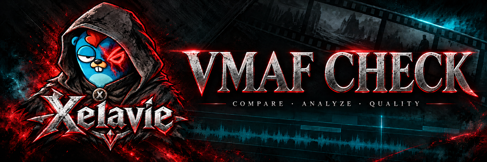
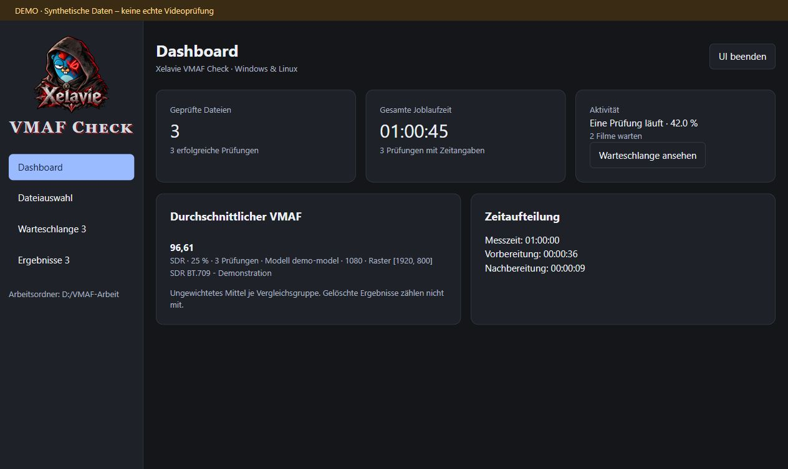
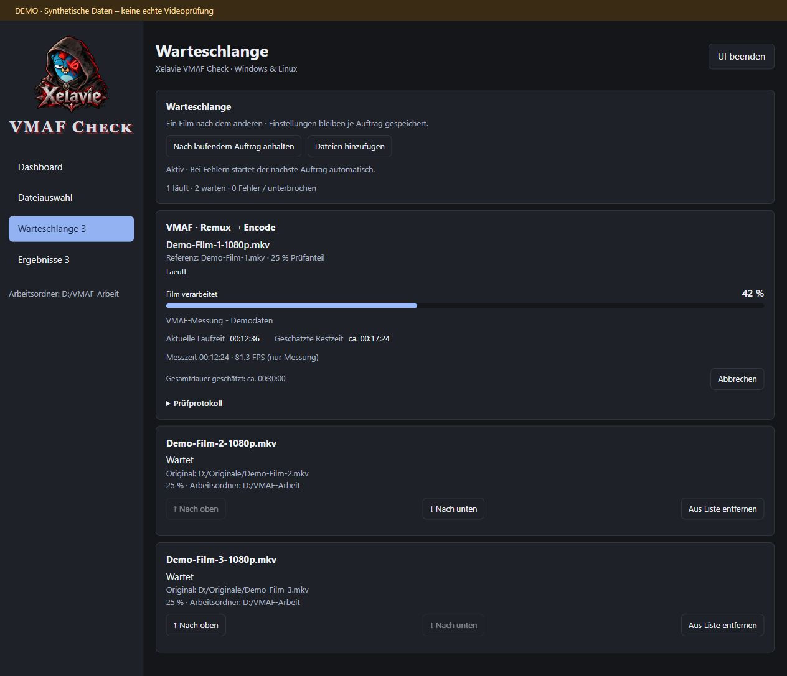
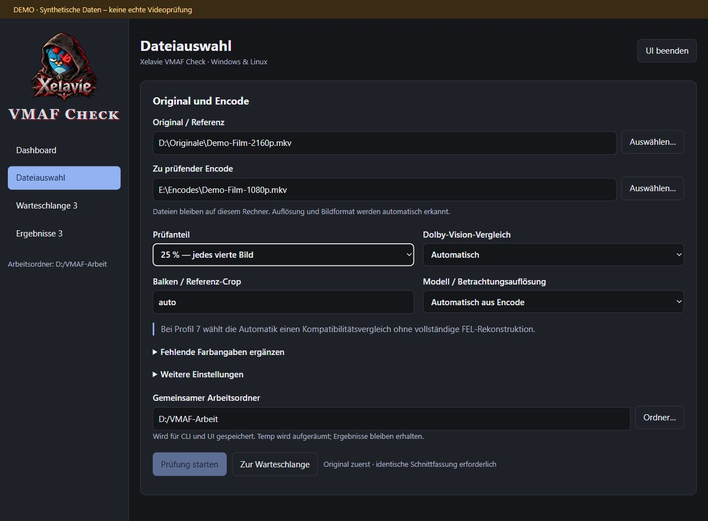
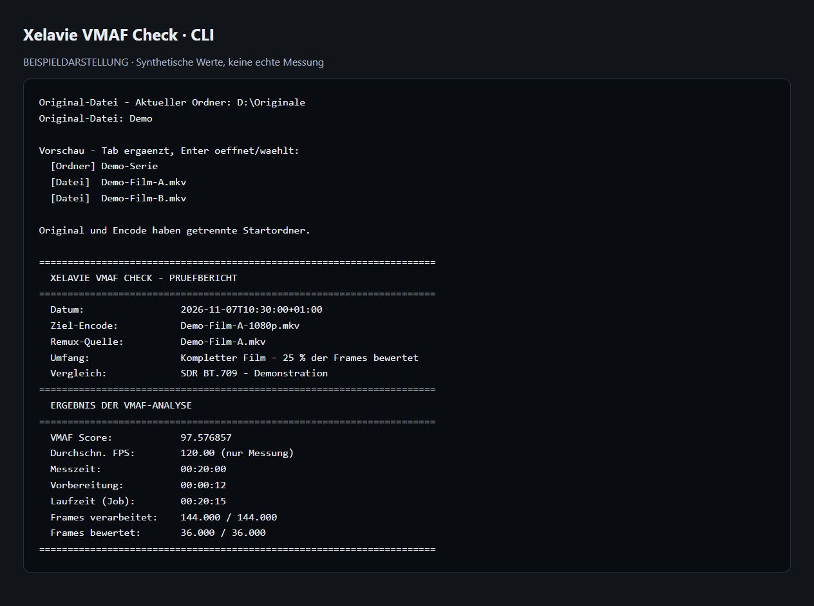

# Xelavie VMAF Check

**Lokale Videoqualitätsprüfung für Windows und Linux – mit CLI, Browser-UI und Warteschlange.**

Vergleiche einen Encode mit seiner Originaldatei über den gesamten Film. Xelavie VMAF Check organisiert FFmpeg, Modelle, Crop-Erkennung und Ergebnisberichte. Deine Videos bleiben auf deinem Rechner.

**Aktueller Stand: `0.1.0-nightly.1` · Release-Kanal: `nightly` · MIT-Lizenz**

Dies ist eine Vorabversion. Die erste stabile Veröffentlichung ist als `v0.1.0` vorgesehen. Echte SDR-Prüfungen unter Windows wurden durchgeführt; vollständige HDR-/HLG-/Dolby-Vision-Videoläufe sind noch nicht validiert.

## Download

Unter [Releases](https://github.com/Xelator23/Xelavie-VMAF-Check/releases/tag/nightly) stehen getrennte Pakete bereit:

| System | Download | Start |
| --- | --- | --- |
| Windows | `Xelavie-VMAF-Check-0.1.0-nightly.1-Windows.zip` | `vmaf-check.cmd` |
| Linux | `Xelavie-VMAF-Check-0.1.0-nightly.1-Linux.tar.gz` | `sh ./vmaf-check.sh` |

**Empfohlen: [Paket herunterladen, SHA256 prüfen und erst danach lokal starten](INSTALLATION.md).** Kein `curl | bash`, kein `irm | iex` und keine Administratorrechte für das portable Paket.

Die Pakete enthalten denselben Python-Prüfcode und dieselbe UI, jeweils mit dem passenden Starter. SHA256-Prüfsummen stehen im Release. FFmpeg und Modelle werden bei Bedarf separat heruntergeladen; Treiber werden nicht installiert.

## Funktionen

- Startauswahl zwischen interaktiver CLI und lokaler Browser-UI.
- Dashboard, Dateiauswahl, persistente Warteschlange und kompakte Ergebnisse.
- Fehlerhafte Aufträge halten die Warteschlange nicht auf; erfolgreiche verschwinden automatisch aus der Warteschlange und bleiben als Ergebnis erhalten.
- 100 %, 50 % oder 25 % der Frames über die gesamte Filmlänge bewerten.
- Auflösung und VMAF-Modell aus dem Encode ableiten; Referenz auf dessen aktives Bildraster skalieren.
- Automatische Erkennung schwarzer Balken, mit manuellen Crop-Optionen.
- Frameanzahl zunächst aus Videometadaten; vollständiger Scan nur bei fehlenden, ungültigen oder widersprüchlichen Angaben.
- SDR BT.709, HDR10/PQ und HLG-Pipeline; Dolby-Vision-Modi für Profile 5, 7, 8 und 10 mit dokumentierten Grenzen.
- Gemeinsamer, gespeicherter Arbeitsordner mit `Temp` und `Ergebnisse`.
- Fortschritt, Laufzeit, Restzeitschätzung sowie getrennte Vorbereitung und Messzeit. FPS beziehen sich nur auf die Messung.
- JSON-, CSV- und Protokolldateien; Ergebnisberichte können in der UI gelöscht werden.
- Getrennt gemerkte Original-/Encode-Ordner, Tab-Vervollständigung und Farbauswahl in der CLI. Live-Pfadvorschau unter Windows; unter Linux Trefferanzeige mit zweimal Tab.

## Beispielbilder

Die folgenden Bilder zeigen die echte UI mit **synthetischen Demodaten**. Die Werte sind keine Messnachweise. Die CLI-Abbildung ist eine beschriftete Beispieldarstellung.

### Dashboard



### Warteschlange



### Dateiauswahl



### CLI



## Schnellstart

Nach dem Herunterladen und Prüfen gemäß [Installationsanleitung](INSTALLATION.md), im entpackten Programmordner:

### Windows

Doppelklicke auf `vmaf-check.cmd` oder starte im entpackten Ordner:

```powershell
.\vmaf-check.cmd
```

Direkter Start mit bekannten BT.709-Limited-Quellen:

```powershell
.\vmaf-check.cmd "D:\Originale\Film.mkv" "E:\Encodes\Film-1080p.mkv" --percent 25 --work-dir "D:\VMAF-Arbeit" --ref-color bt709 --enc-color bt709
```

### Linux

```sh
tar -xzf Xelavie-VMAF-Check-0.1.0-nightly.1-Linux.tar.gz
cd Xelavie-VMAF-Check
sh ./vmaf-check.sh
```

Direkter Start ohne Farb-Overrides:

```sh
sh ./vmaf-check.sh "/mnt/originale/Film.mkv" "/mnt/encodes/Film-1080p.mkv" --percent 25 --work-dir "/mnt/vmaf-arbeit"
```

`--ui` startet die Browser-UI, `--cli` die interaktive Auswahl. Diese beiden Schalter jeweils allein verwenden. `--help` zeigt die Optionen des direkten Aufrufs. Ist Python 3.10+ vorhanden, geht auch `python vmaf_launcher.py` beziehungsweise `python3 vmaf_launcher.py`.

## Bedienung

**UI:** Unter „Dateiauswahl“ Original, Encode, Prüfanteil und Arbeitsordner setzen. „Prüfung starten“ startet die Warteschlange; „Zur Warteschlange“ reiht einen weiteren Vergleich ein. Wartende Aufträge können verschoben werden. „Abbrechen“ stoppt den aktuellen Lauf und pausiert die Warteschlange. Bei normalen Fehlern geht es automatisch weiter. Nach einem Neustart ist die Warteschlange zunächst pausiert.

Das Prüfprotokoll ist einklappbar und öffnet sich bei Fehlern. Fortschritt und Restzeit sind Arbeitsanzeigen, keine geschätzten VMAF-Scores. „UI beenden“ beendet den lokalen Dienst; allein das Schließen des Browser-Tabs beendet ihn nicht.

**CLI:** Original, Encode und Prüfanteil werden nacheinander abgefragt. Danach folgen getrennte Farbmodi: Automatisch, BT.709/SDR, HDR10/PQ oder HLG. Bei einem Preset wird zusätzlich Limited/Full abgefragt. Presets nur verwenden, wenn die tatsächlichen Quelleigenschaften bekannt sind; sie überschreiben vorhandene Angaben.

| Eingabe | Wirkung |
| --- | --- |
| Vollständiger Dateipfad | Datei direkt wählen, auch in einem anderen Ordner/Laufwerk |
| Vollständiger Ordnerpfad | Ordner öffnen |
| `cd ..` | Eine Ebene nach oben |
| `cd "Unterordner"` | Unterordner öffnen |
| `D:` | Unter Windows Laufwerkswurzel öffnen |
| `dir` / `ls` | Ordnerinhalt anzeigen |
| Tab | Pfad vervollständigen |
| Strg+U | Eingabe leeren |
| Strg+C | Abbrechen |

Unter Windows zeigt die CLI bei unterstützter Konsole eine gefilterte Vorschau beim Tippen. Unter Linux verwendet sie `readline`: zweimal Tab zeigt mehrere Treffer. Ohne `readline` bleibt die normale Texteingabe verfügbar.

## Vergleichsbedingungen und Grenzen

- Original und Encode brauchen dieselbe Schnittfassung, denselben Startframe und dieselbe konstante Bildrate. Es gibt keine automatische Synchronisierung oder Schnittkorrektur.
- 25 % bedeutet jedes vierte Bild über den **ganzen Film**; die Decoder lesen weiterhin alle Frames. Die Laufzeit sinkt daher nicht zwingend auf ein Viertel.
- Der Vergleich erfolgt auf der Zielauflösung des Encodes. Ein 1080p-Encode wird damit nicht als Wiedergabe auf einem gemeinsamen 4K-Raster bewertet.
- Crop ist eine Heuristik. Dunkle Szenen, Untertitel oder wechselnde Seitenverhältnisse können manuelle Einstellungen erfordern. Abweichende aktive Seitenverhältnisse werden nicht automatisch gestreckt.
- Fehlende Farbmetadaten werden nicht aus der Auflösung geraten. FFprobe liest Container/Bitstream; bleiben notwendige Angaben unbekannt, müssen bekannte Quellwerte angegeben werden. Ein Farb-Preset wandelt SDR nicht in HDR um. SDR gegen HDR ist ausgeschlossen.
- HLG wird unter einer festgelegten 1000-cd/m²-Normalisierung nach PQ umgerechnet. HDR10+ wird anhand seiner PQ-Bilder bewertet, nicht als dynamische HDR10+-Wiedergabe.
- Dolby Vision benötigt passende FFmpeg/libplacebo-Funktionen und ein funktionierendes Vulkan-Gerät samt Treiber. Profile 5/8/10 verwenden dekodierte DV-Metadaten; Profil 10 erfordert AV1.
- **Profil 7:** Im Automatikmodus erfolgt ein Kompatibilitätsvergleich nach P8.1-Konvertierung mit verworfenem Enhancement Layer. **Keine vollständige FEL-Rekonstruktion.** Ein hoher Score beweist keine gleichwertige vollständige P7-Wiedergabe. Die berücksichtigten Profilpaarungen 5/7/8/10 sind kein Nachweis erfolgreicher realer Videoläufe für jede Paarung.

Details zu Crop, Modellen, Farb-Overrides, Dolby-Vision-Modi und Offline-Betrieb stehen in [ANLEITUNG.txt](ANLEITUNG.txt).

## Voraussetzungen und Downloads

Windows benötigt PowerShell 5.1+. Linux benötigt eine passende glibc; Alpine/musl ist kein zugesichertes Ziel. Die automatischen Werkzeugdownloads berücksichtigen x64/ARM64, wobei die Verfügbarkeit passender Upstream-Builds entscheidend bleibt.

Fehlt Python 3.10+, können die Starter temporär uv/Python herunterladen. Unter Linux werden dafür `curl` oder `wget`, `tar`, `sha256sum` und `mktemp` benötigt. Dieser vorgeschaltete Bootstrap verwendet **System-Temp** (Linux: `TMPDIR`); die eigentlichen Video-Arbeitsdateien verwenden den gewählten Arbeitsordner.

FFmpeg/FFprobe, VMAF-Modelle und bei Bedarf `dovi_tool` werden automatisch geladen. HTTPS-Zertifikatsprüfung bleibt aktiv. Bei `--no-download` müssen alle benötigten Werkzeuge und das mit `--model` gewählte Modell lokal vorhanden sein. `--download-tools` erzwingt einen frischen FFmpeg-Build. Unterschiedliche Builds können Verhalten und Ergebnisse beeinflussen; Versionen und Modellhash werden protokolliert.

Die UI ist ausschließlich an `127.0.0.1` gebunden. Videos werden nicht hochgeladen. Berichte enthalten lokale Dateipfade – vor dem Teilen von Fehlerberichten persönliche Angaben entfernen.

## Entwicklung und Tests

Nur Python-Standardbibliothek, keine `pip`-Pakete erforderlich:

```sh
python -B -m unittest discover -s . -p "test_*.py" -v
```

Die Tests prüfen Offline-Logik, CLI, Crop-Entscheidungen, Farbmetadaten, Download-Verifikation, lokalen HTTP-Server, Warteschlange und Ergebnisverwaltung. Sie ersetzen keine echten HDR-/DV-Videoläufe. Die GitHub-Actions-Matrix prüft Windows und Linux mit Python 3.10 und 3.12.

Fehler und Verbesserungsvorschläge bitte über [Issues](https://github.com/Xelator23/Xelavie-VMAF-Check/issues) melden. Hilfreich sind Version, Betriebssystem, Vergleichsmodus und ein bereinigtes Protokoll.

## Lizenz und verwendete Projekte

Der Projektcode steht unter der [MIT-Lizenz](LICENSE). Separat heruntergeladene Programme und Modelle behalten ihre eigenen Lizenzen; siehe [THIRD_PARTY_NOTICES.md](THIRD_PARTY_NOTICES.md).

Basierend auf [Netflix VMAF](https://github.com/Netflix/vmaf), [FFmpeg](https://ffmpeg.org/), [BtbN FFmpeg Builds](https://github.com/BtbN/FFmpeg-Builds), [dovi_tool](https://github.com/quietvoid/dovi_tool), [libplacebo](https://code.videolan.org/videolan/libplacebo) und [uv](https://github.com/astral-sh/uv). Dies ist ein unabhängiges Projekt, keine Dolby-zertifizierte Prüflösung.
